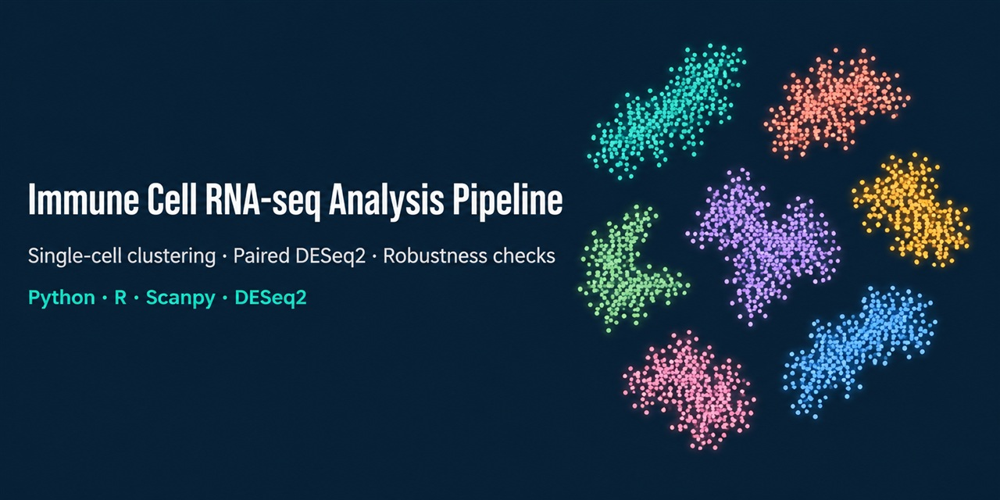
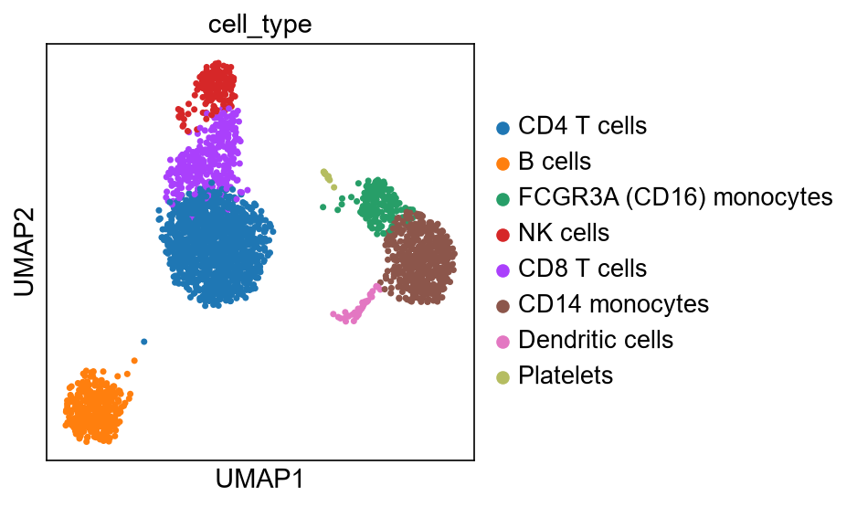
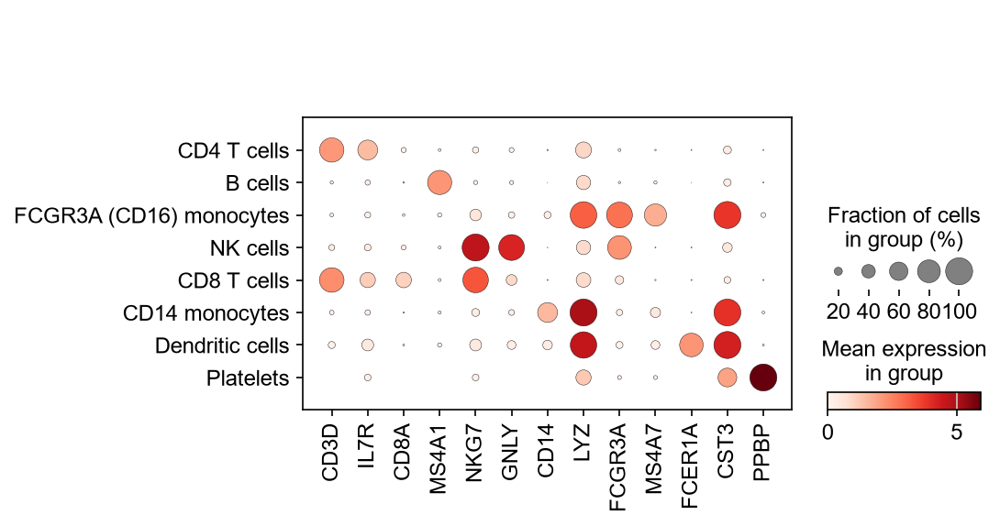
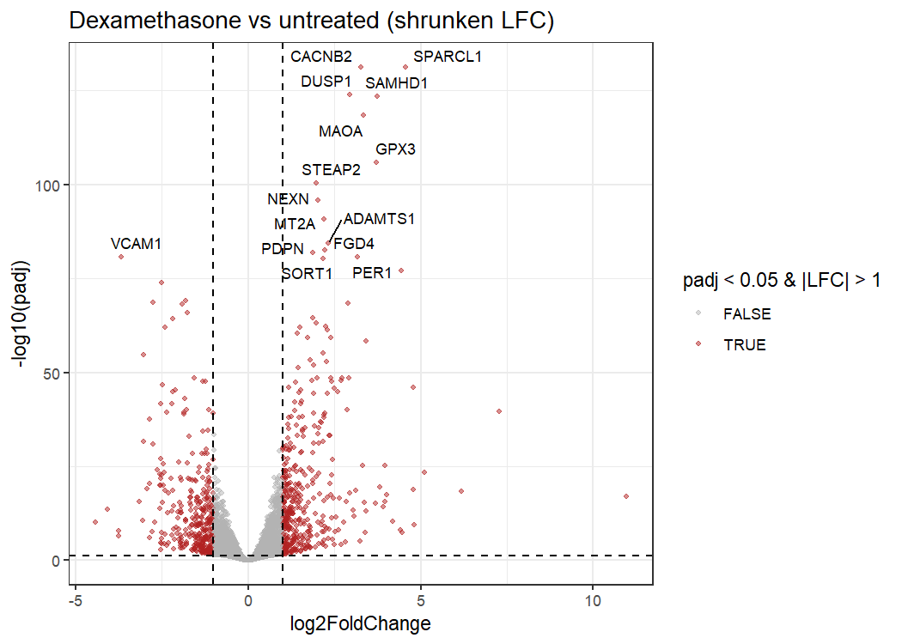
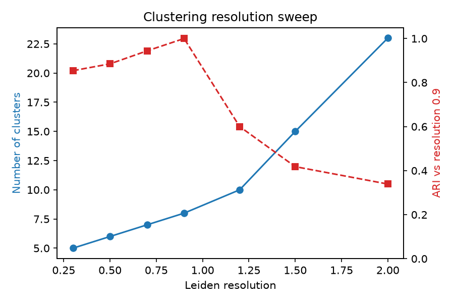

# Immune Cell Omics Analysis Pipeline

A reproducible analysis of two public immune-related datasets, with statistical checks on top of standard workflows.

- **Part A (Python, Scanpy):** single-cell RNA-seq of about 2,700 human peripheral blood mononuclear cells (10x Genomics PBMC 3k). QC, normalization, PCA, UMAP, t-SNE, Leiden clustering, marker genes, cell-type labels.
- **Part B (R, DESeq2):** bulk RNA-seq of airway smooth muscle cells from four donors, with and without dexamethasone (Bioconductor `airway`, Himes et al. 2014). Paired differential expression, shrinkage, PCA, volcano, MA plot, heatmap, GO enrichment.
- **Rigor checks:** cross-validated classifiers, clustering resolution and seed sensitivity, number of PCs, raw versus FDR-adjusted p-values, paired versus unpaired design, and a within-donor label permutation test.

## What this project is and is not

These are public tutorial datasets, analyzed with established workflows. The project does not claim new biology. My contribution is:

1. a pipeline that runs end to end and reproduces the same numbers,
2. checks on whether the results hold up when choices change (resolution, seeds, design, labels),
3. my own written interpretation of each result.

The classifier labels come from the clustering itself, so its accuracy shows the clusters are internally consistent in PCA space. It does not show they are biologically correct.

## Results

Every number below comes from [`results/numbers.md`](results/numbers.md), which records the notebook section that printed it. The whole pipeline was rerun from scratch, with downloaded and intermediate data deleted, and reproduced the same numbers.

| Question | Result |
|---|---|
| Cells kept after QC | 2,638 of 2,700 |
| Leiden clusters (resolution 0.9) | 8 |
| Cell types labeled | 8: CD4 T, CD8 T, B, NK, CD14 monocytes, FCGR3A monocytes, dendritic cells, platelets |
| DE genes at 5% FDR, `~ cell + dex` | 4,081 (2,190 up, 1,891 down) |
| DE genes at 5% FDR, `~ dex` only | 2,773 |
| Known glucocorticoid targets recovered | 5 of 5 up-regulated (FKBP5, DUSP1, PER1, TSC22D3, CRISPLD2) |
| Cross-validated accuracy (logistic regression / random forest) | 0.960 ± 0.009 / 0.959 ± 0.009 |
| Permutation null: median DE genes across shuffled labelings | 0 (max 20, over 14 within-donor shufflings; real: 4,081) |

<table>
<tr>
<td></td>
<td></td>
</tr>
<tr>
<td></td>
<td></td>
</tr>
</table>

### Interpretation

In PBMC 3k, standard QC and Leiden clustering give eight groups. Each one maps cleanly onto a canonical blood cell type by its markers, and T cells make up over half the cells. The partition barely changes with the random seed (ARI 0.95 to 1.00) but does depend on resolution and on how many PCs build the neighbor graph, so the cluster count reflects analysis choices as well as biology. In the airway data, all five known glucocorticoid-response genes come out strongly up-regulated, and treatment is the main axis of variation (PC1, 48%). Modeling donor as well as treatment finds about 47% more DE genes than ignoring donors, because the stable donor-to-donor differences stop counting as noise. The within-donor permutation test supports the result: shuffled labelings give 0 to 20 DE genes, against 4,081 for the real labels.

## Repository layout

```
notebooks/
  01_pbmc3k_scanpy.ipynb     Part A
  02_airway_deseq2.Rmd       Part B (includes its own rigor checks)
  02_airway_deseq2.md        Part B rendered with outputs (readable on GitHub)
  03_rigor_checks.ipynb      Rigor checks for Part A
r/install_packages.R         One-time R package install
results/figures/             Saved plots
results/tables/              Saved CSVs
results/numbers.md           Log of every number used in this README
data/processed/              Intermediate files (git-ignored)
environment.yml              Python environment
```

The notebooks are committed with their outputs, and the rendered Part B report is [`notebooks/02_airway_deseq2.md`](notebooks/02_airway_deseq2.md).

## How to run

**Python (Part A and rigor checks)**

```bash
conda env create -f environment.yml
conda activate immune-omics
jupyter lab
```

Run `01_pbmc3k_scanpy.ipynb` first. It downloads PBMC 3k and saves `data/processed/pbmc3k_processed.h5ad`, which `03_rigor_checks.ipynb` reads.

**R (Part B)**

Install R (4.4 or newer) and RStudio, then run once:

```r
source("r/install_packages.R")
```

Open `notebooks/02_airway_deseq2.Rmd` in RStudio and click Knit, or run the chunks one at a time. To build both the GitHub markdown and the HTML report from the command line (pandoc is needed, and it comes with RStudio):

```bash
cd notebooks
Rscript -e 'rmarkdown::render("02_airway_deseq2.Rmd", output_format = "all")'
```

Package versions are printed at the top of each Python notebook and at the end of the R report (`sessionInfo()`). The results above were produced with Python 3.11, scanpy 1.11.5, R 4.6.2 and DESeq2 1.52.0 (Bioconductor 3.23).

## Limitations

- PBMC 3k comes from one healthy donor, so it says nothing about disease or variation between people.
- `airway` has four donors. That is enough to show the paired design but too few for strong claims.
- Cell-type labels rely on canonical markers and manual assignment, not a reference atlas.

## Data sources

- 10x Genomics PBMC 3k, loaded with `scanpy.datasets.pbmc3k()`
- Himes BE et al. (2014) RNA-Seq transcriptome profiling identifies CRISPLD2 as a glucocorticoid responsive gene that modulates cytokine function in airway smooth muscle cells. PLoS ONE 9(6): e99625. Data from the Bioconductor `airway` package.

## License

Code in this repository is released under the [MIT License](LICENSE). The datasets belong to their original authors and are subject to their own terms.
