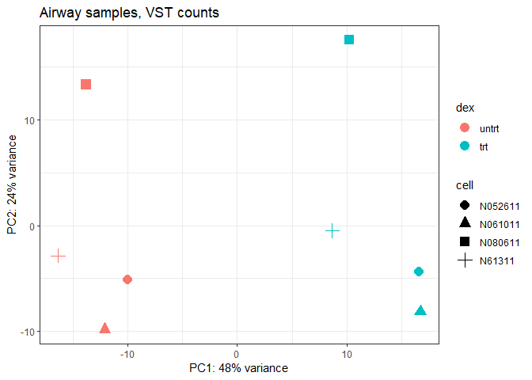
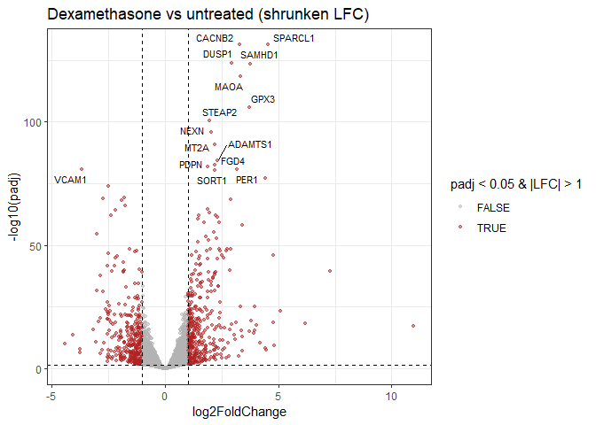
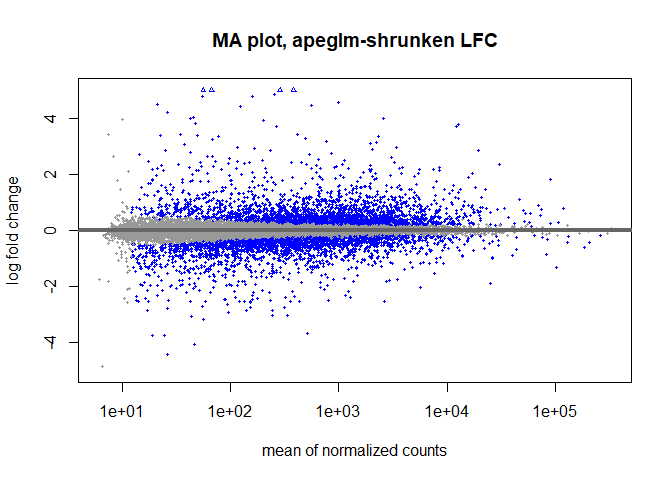
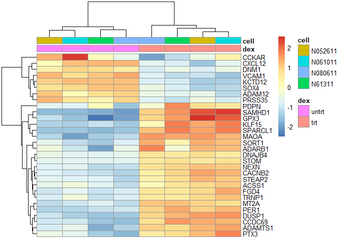
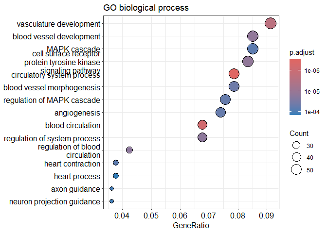

Part B: Differential expression in dexamethasone-treated airway cells
================

- [1. Data](#1-data)
- [2. Design and low-count filtering](#2-design-and-low-count-filtering)
- [3. Fit and results](#3-fit-and-results)
- [4. Shrinkage](#4-shrinkage)
- [5. Sanity check against known
  biology](#5-sanity-check-against-known-biology)
- [6. PCA on variance-stabilized
  counts](#6-pca-on-variance-stabilized-counts)
- [7. Volcano and MA plots](#7-volcano-and-ma-plots)
- [8. Heatmap of top 30 genes](#8-heatmap-of-top-30-genes)
- [9. GO enrichment](#9-go-enrichment)
- [Rigor checks](#rigor-checks)
  - [R1. Raw p-values versus FDR](#r1-raw-p-values-versus-fdr)
  - [R2. Paired versus unpaired
    design](#r2-paired-versus-unpaired-design)
  - [R3. Within-donor permutation
    test](#r3-within-donor-permutation-test)
- [Session info](#session-info)

## 1. Data

The `airway` dataset has 8 samples: airway smooth muscle cells from 4
donors (`cell`), each treated or untreated with dexamethasone (`dex`), a
glucocorticoid. Because every donor gives one treated and one untreated
sample, the design is **paired**. Donors differ from one another at
baseline, so we model donor as well as treatment.

``` r
library(airway)
library(DESeq2)
library(ggplot2)
library(ggrepel)
library(pheatmap)
library(apeglm)
library(clusterProfiler)
library(org.Hs.eg.db)

data("airway")
se <- airway
se$dex <- relevel(se$dex, ref = "untrt")   # untreated is the baseline
as.data.frame(colData(se))[, c("cell", "dex")]
```

    ##               cell   dex
    ## SRR1039508  N61311 untrt
    ## SRR1039509  N61311   trt
    ## SRR1039512 N052611 untrt
    ## SRR1039513 N052611   trt
    ## SRR1039516 N080611 untrt
    ## SRR1039517 N080611   trt
    ## SRR1039520 N061011 untrt
    ## SRR1039521 N061011   trt

``` r
dim(se)
```

    ## [1] 63677     8

## 2. Design and low-count filtering

`~ cell + dex` tells DESeq2 to estimate each donor’s baseline, then test
the dex effect inside donors. The variable you test goes last.

Genes with almost no reads cannot reach significance. Keeping them only
adds to the number of tests. We keep genes with at least 10 reads in at
least 4 samples (4 is the size of the smallest group).

``` r
dds <- DESeqDataSet(se, design = ~ cell + dex)
keep <- rowSums(counts(dds) >= 10) >= 4
dds <- dds[keep, ]
n_genes_kept <- nrow(dds)
n_genes_kept
```

    ## [1] 16139

## 3. Fit and results

`DESeq()` estimates size factors (sequencing depth), dispersions
(gene-level variability shared across genes) and fits a negative
binomial model per gene. `alpha = 0.05` sets the FDR target used for
independent filtering.

``` r
dds <- DESeq(dds)
resultsNames(dds)
```

    ## [1] "Intercept"               "cell_N061011_vs_N052611"
    ## [3] "cell_N080611_vs_N052611" "cell_N61311_vs_N052611" 
    ## [5] "dex_trt_vs_untrt"

``` r
res <- results(dds, name = "dex_trt_vs_untrt", alpha = 0.05)
summary(res)
```

    ## 
    ## out of 16139 with nonzero total read count
    ## adjusted p-value < 0.05
    ## LFC > 0 (up)       : 2190, 14%
    ## LFC < 0 (down)     : 1891, 12%
    ## outliers [1]       : 0, 0%
    ## low counts [2]     : 313, 1.9%
    ## (mean count < 10)
    ## [1] see 'cooksCutoff' argument of ?results
    ## [2] see 'independentFiltering' argument of ?results

``` r
sig <- subset(res, padj < 0.05)
n_sig  <- nrow(sig)
n_up   <- sum(sig$log2FoldChange > 0)
n_down <- sum(sig$log2FoldChange < 0)
c(total = n_sig, up = n_up, down = n_down)
```

    ## total    up  down 
    ##  4081  2190  1891

## 4. Shrinkage

With 4 donors, log2 fold changes for low-count genes are noisy. apeglm
pulls unreliable estimates toward zero. Use shrunken values for ranking
and plots. The p-values stay the same.

``` r
res_lfc <- lfcShrink(dds, coef = "dex_trt_vs_untrt", type = "apeglm")

symbols <- mapIds(org.Hs.eg.db, keys = rownames(res_lfc), column = "SYMBOL",
                  keytype = "ENSEMBL", multiVals = "first")
res_df <- as.data.frame(res_lfc)
res_df$ensembl <- rownames(res_df)
res_df$symbol  <- symbols
res_df <- res_df[order(res_df$padj), ]
write.csv(res_df, file.path(tab_dir, "airway_deseq2_results.csv"), row.names = FALSE)
head(res_df[, c("symbol", "baseMean", "log2FoldChange", "padj")], 20)
```

    ##                  symbol   baseMean log2FoldChange          padj
    ## ENSG00000152583 SPARCL1   997.9612       4.555676 5.530127e-132
    ## ENSG00000165995  CACNB2   495.5675       3.276456 5.530127e-132
    ## ENSG00000120129   DUSP1  3411.9661       2.935137 1.248569e-124
    ## ENSG00000101347  SAMHD1 12712.9456       3.754493 2.909302e-124
    ## ENSG00000189221    MAOA  2343.5733       3.337353 3.538038e-119
    ## ENSG00000211445    GPX3 12298.1966       3.711558 1.344901e-106
    ## ENSG00000157214  STEAP2  3012.8580       1.963647 3.955211e-101
    ## ENSG00000162614    NEXN  5399.1360       2.022927  1.212676e-96
    ## ENSG00000125148    MT2A  3659.6960       2.196818  1.961381e-91
    ## ENSG00000154734 ADAMTS1 30345.8486       2.330306  4.017702e-85
    ## ENSG00000139132    FGD4  1224.5679       2.212954  2.605756e-83
    ## ENSG00000162493    PDPN  1100.7830       1.878499  1.474840e-82
    ## ENSG00000162692   VCAM1   509.6577      -3.677951  1.828073e-81
    ## ENSG00000179094    PER1   777.0989       3.171141  1.828073e-81
    ## ENSG00000134243   SORT1  5516.9030       2.180506  4.001172e-81
    ## ENSG00000163884   KLF15   561.4144       4.429114  7.653841e-78
    ## ENSG00000178695  KCTD12  2657.2183      -2.515800  1.018134e-74
    ## ENSG00000148848  ADAM12  1368.6695      -1.807406  7.126242e-70
    ## ENSG00000146250  PRSS35   314.6698      -2.743641  1.826944e-69
    ## ENSG00000198624  CCDC69  2059.0279       2.895198  4.241700e-69

## 5. Sanity check against known biology

Glucocorticoids are known to induce FKBP5, DUSP1, PER1 and TSC22D3.
CRISPLD2 was the headline gene in Himes et al. 2014. If these are not
up-regulated, something upstream is wrong.

``` r
known <- c("FKBP5", "DUSP1", "PER1", "TSC22D3", "CRISPLD2")
res_df[res_df$symbol %in% known, c("symbol", "log2FoldChange", "padj")]
```

    ##                   symbol log2FoldChange          padj
    ## ENSG00000120129    DUSP1       2.935137 1.248569e-124
    ## ENSG00000179094     PER1       3.171141  1.828073e-81
    ## ENSG00000103196 CRISPLD2       2.602017  1.563223e-45
    ## ENSG00000096060    FKBP5       3.966270  7.296620e-26
    ## ENSG00000157514  TSC22D3       3.113603  3.177825e-19

**Interpretation.** All five known glucocorticoid-response genes are
up-regulated in treated cells and all are far past the FDR cutoff: FKBP5
(shrunken log2FC 3.97, about 16-fold), PER1 (3.17), TSC22D3 (3.11),
DUSP1 (2.94) and CRISPLD2 (2.60). DUSP1 and PER1 are among the top 15
genes overall. The expected biology comes out in the expected direction,
so the sample labels, the reference level and the contrast are set up
correctly.

## 6. PCA on variance-stabilized counts

VST puts counts on a scale where variance does not depend on the mean,
so PCA isn’t dominated by highly expressed genes. `blind = FALSE` uses
the design when estimating the transform.

``` r
vsd <- vst(dds, blind = FALSE)
pca_df <- plotPCA(vsd, intgroup = c("dex", "cell"), returnData = TRUE)
pv <- round(100 * attr(pca_df, "percentVar"))
p_pca <- ggplot(pca_df, aes(PC1, PC2, color = dex, shape = cell)) +
  geom_point(size = 4) +
  labs(x = paste0("PC1: ", pv[1], "% variance"), y = paste0("PC2: ", pv[2], "% variance"),
       title = "Airway samples, VST counts") +
  theme_bw()
ggsave(file.path(fig_dir, "airway_pca.png"), p_pca, width = 6, height = 4.5, dpi = 150)
p_pca
```

<!-- -->

**Interpretation.** PC1 (48% of variance) splits the samples cleanly by
treatment: all untreated samples sit on the left and all treated samples
on the right. PC2 (24%) separates donors, mostly donor N080611 from the
other three, and each donor keeps roughly the same PC2 position whether
treated or not. So about a quarter of the variation is a stable donor
baseline that has nothing to do with dexamethasone. Putting `cell` in
the design lets DESeq2 account for that baseline instead of treating it
as noise.

## 7. Volcano and MA plots

``` r
vdf <- res_df[!is.na(res_df$padj), ]
vdf$sig <- vdf$padj < 0.05 & abs(vdf$log2FoldChange) > 1
top_lab <- head(vdf[vdf$sig, ], 15)
p_vol <- ggplot(vdf, aes(log2FoldChange, -log10(padj), color = sig)) +
  geom_point(alpha = 0.5, size = 1) +
  geom_text_repel(data = top_lab, aes(label = symbol), color = "black", size = 3, max.overlaps = 20) +
  scale_color_manual(values = c(`FALSE` = "grey70", `TRUE` = "firebrick")) +
  geom_vline(xintercept = c(-1, 1), linetype = "dashed") +
  geom_hline(yintercept = -log10(0.05), linetype = "dashed") +
  labs(title = "Dexamethasone vs untreated (shrunken LFC)", color = "padj < 0.05 & |LFC| > 1") +
  theme_bw()
ggsave(file.path(fig_dir, "airway_volcano.png"), p_vol, width = 7, height = 5, dpi = 150)
p_vol
```

<!-- -->

``` r
png(file.path(fig_dir, "airway_ma.png"), width = 900, height = 650, res = 150)
plotMA(res_lfc, ylim = c(-5, 5), main = "MA plot, apeglm-shrunken LFC")
invisible(dev.off())
plotMA(res_lfc, ylim = c(-5, 5), main = "MA plot, apeglm-shrunken LFC")
```

<!-- -->

## 8. Heatmap of top 30 genes

Rows are centered so each gene shows deviation from its own mean.

``` r
top30 <- head(rownames(res_df)[!is.na(res_df$padj)], 30)
mat <- assay(vsd)[top30, ]
mat <- mat - rowMeans(mat)
rownames(mat) <- ifelse(is.na(symbols[top30]), top30, symbols[top30])
ann <- as.data.frame(colData(vsd)[, c("dex", "cell")])
ph <- pheatmap(mat, annotation_col = ann, show_colnames = FALSE, silent = TRUE)
png(file.path(fig_dir, "airway_heatmap_top30.png"), width = 7, height = 8, units = "in", res = 150)
grid::grid.draw(ph$gtable)
invisible(dev.off())
grid::grid.newpage()
grid::grid.draw(ph$gtable)
```

<!-- -->

## 9. GO enrichment

The universe is every gene that was tested, not the whole genome. Using
the whole genome inflates enrichment because untested genes can never be
“significant.”

``` r
sig_genes <- rownames(res_df)[which(res_df$padj < 0.05 & abs(res_df$log2FoldChange) > 1)]
ego <- enrichGO(gene = sig_genes, universe = rownames(dds), OrgDb = org.Hs.eg.db,
                keyType = "ENSEMBL", ont = "BP", pAdjustMethod = "BH",
                qvalueCutoff = 0.05, readable = TRUE)
write.csv(as.data.frame(ego), file.path(tab_dir, "airway_go_bp.csv"), row.names = FALSE)
p_go <- enrichplot::dotplot(ego, showCategory = 15) + ggtitle("GO biological process")
ggsave(file.path(fig_dir, "airway_go_dotplot.png"), p_go, width = 8, height = 6, dpi = 150)
p_go
```

<!-- -->

**Interpretation.** The top terms are about vascular and circulatory
biology (circulatory system process, blood vessel development,
angiogenesis, regulation of blood circulation), receptor tyrosine kinase
signaling, and regulation of the MAPK cascade. This fits the cell type
and the drug. Airway smooth muscle cells control contractility and
tissue remodeling, and glucocorticoids are known to dampen inflammatory
MAPK signaling, partly by inducing the phosphatase DUSP1 seen above. GO
enrichment only describes which gene sets are over-represented, so these
terms are hypotheses about function, not evidence of it.

# Rigor checks

## R1. Raw p-values versus FDR

About 16139 genes were tested. At p \< 0.05 with no true effects you
would still expect about 5% false positives. Benjamini-Hochberg controls
the expected share of false discoveries among the genes you call
significant.

``` r
n_raw <- sum(res$pvalue < 0.05, na.rm = TRUE)
n_adj <- sum(res$padj < 0.05, na.rm = TRUE)
expected_false_raw <- round(0.05 * sum(!is.na(res$pvalue)))
c(raw_p_lt_0.05 = n_raw, padj_lt_0.05 = n_adj, expected_false_if_no_effects = expected_false_raw)
```

    ##                raw_p_lt_0.05                 padj_lt_0.05 
    ##                         5488                         4081 
    ## expected_false_if_no_effects 
    ##                          807

## R2. Paired versus unpaired design

``` r
dds_unpaired <- DESeqDataSet(se[keep, ], design = ~ dex)
dds_unpaired <- DESeq(dds_unpaired, quiet = TRUE)
res_unpaired <- results(dds_unpaired, name = "dex_trt_vs_untrt", alpha = 0.05)
n_unpaired <- sum(res_unpaired$padj < 0.05, na.rm = TRUE)
c(paired = n_adj, unpaired = n_unpaired)
```

    ##   paired unpaired 
    ##     4081     2773

**Interpretation.** The paired design finds 4,081 DE genes and the
unpaired design finds 2,773, about 47% more with pairing. In `~ dex`,
the donor-to-donor differences seen on PC2 have nowhere to go, so they
end up in the residual variance and make each gene’s treatment effect
look noisier. In `~ cell + dex`, each donor’s baseline is estimated
separately and the treatment effect is measured within donors, so the
residual variance is smaller and more genes pass the same FDR cutoff.
Here pairing costs 3 degrees of freedom and gains a lot of power.

## R3. Within-donor permutation test

Shuffle treatment labels **inside each donor** so the pairing stays
intact, refit, and count DE genes. With 4 donors there are 2^4 = 16
labelings. One is the real labeling. Flipping all 4 donors swaps
“treated” and “untreated” everywhere, so it gives the same count with
every fold change reversed. That leaves 14 labelings that mix the
treatment signal, which serve as the null. This takes a few minutes.

``` r
cells <- levels(se$cell)
flips <- as.matrix(expand.grid(rep(list(c(FALSE, TRUE)), length(cells))))
colnames(flips) <- cells

perm_counts <- integer(nrow(flips))
for (i in seq_len(nrow(flips))) {
  se_p <- se[keep, ]
  d <- as.character(se_p$dex)
  for (cl in cells[flips[i, ]]) {
    idx <- se_p$cell == cl
    d[idx] <- ifelse(d[idx] == "trt", "untrt", "trt")
  }
  se_p$dex <- relevel(factor(d), ref = "untrt")
  dp <- DESeq(DESeqDataSet(se_p, design = ~ cell + dex), quiet = TRUE)
  rp <- results(dp, name = "dex_trt_vs_untrt", alpha = 0.05)
  perm_counts[i] <- sum(rp$padj < 0.05, na.rm = TRUE)
}

n_flipped <- rowSums(flips)
perm_df <- data.frame(flips, n_flipped = n_flipped, n_de = perm_counts)
perm_df$type <- ifelse(n_flipped == 0, "real",
                ifelse(n_flipped == length(cells), "all flipped (mirror of real)", "null"))
write.csv(perm_df, file.path(tab_dir, "airway_permutation.csv"), row.names = FALSE)
perm_df
```

    ##    N052611 N061011 N080611 N61311 n_flipped n_de                         type
    ## 1    FALSE   FALSE   FALSE  FALSE         0 4081                         real
    ## 2     TRUE   FALSE   FALSE  FALSE         1    0                         null
    ## 3    FALSE    TRUE   FALSE  FALSE         1    0                         null
    ## 4     TRUE    TRUE   FALSE  FALSE         2    0                         null
    ## 5    FALSE   FALSE    TRUE  FALSE         1   20                         null
    ## 6     TRUE   FALSE    TRUE  FALSE         2    0                         null
    ## 7    FALSE    TRUE    TRUE  FALSE         2    0                         null
    ## 8     TRUE    TRUE    TRUE  FALSE         3    2                         null
    ## 9    FALSE   FALSE   FALSE   TRUE         1    2                         null
    ## 10    TRUE   FALSE   FALSE   TRUE         2    0                         null
    ## 11   FALSE    TRUE   FALSE   TRUE         2    0                         null
    ## 12    TRUE    TRUE   FALSE   TRUE         3   20                         null
    ## 13   FALSE   FALSE    TRUE   TRUE         2    0                         null
    ## 14    TRUE   FALSE    TRUE   TRUE         3    0                         null
    ## 15   FALSE    TRUE    TRUE   TRUE         3    0                         null
    ## 16    TRUE    TRUE    TRUE   TRUE         4 4081 all flipped (mirror of real)

``` r
null_counts <- perm_df$n_de[perm_df$type == "null"]
c(real = perm_df$n_de[perm_df$type == "real"],
  null_median = median(null_counts), null_max = max(null_counts))
```

    ##        real null_median    null_max 
    ##        4081           0          20

**Interpretation.** The real labeling gives 4,081 DE genes. The 14 null
labelings give a median of 0 and a maximum of 20. Ten of the 14 give no
DE genes at all. The null labelings also come in mirror pairs with
identical counts (flipping donor N080611 alone and flipping the other
three both give 20), for the same reason the all-flipped labeling
mirrors the real one. So the real result is about 200 times the worst
null case, and the FDR procedure is not producing thousands of hits from
donor structure alone. One caveat: with only 16 labelings, the smallest
possible permutation p-value is 2/16 = 0.125 (the real labeling and its
mirror), so this test can’t give a small p-value by itself. What it
shows is that the size of the null counts is tiny next to the real one.

# Session info

Package versions used for this run, so the numbers can be reproduced.

``` r
sessionInfo()
```

    ## R version 4.6.2 (2026-10-29 ucrt)
    ## Platform: x86_64-w64-mingw32/x64
    ## Running under: Windows 11 x64 (build 26300)
    ## 
    ## Matrix products: default
    ##   LAPACK version 3.12.1
    ## 
    ## locale:
    ## [1] LC_COLLATE=English_United States.utf8 
    ## [2] LC_CTYPE=English_United States.utf8   
    ## [3] LC_MONETARY=English_United States.utf8
    ## [4] LC_NUMERIC=C                          
    ## [5] LC_TIME=English_United States.utf8    
    ## 
    ## time zone: America/Los_Angeles
    ## tzcode source: internal
    ## 
    ## attached base packages:
    ## [1] stats4    stats     graphics  grDevices utils     datasets  methods  
    ## [8] base     
    ## 
    ## other attached packages:
    ##  [1] org.Hs.eg.db_3.23.1         AnnotationDbi_1.74.0       
    ##  [3] clusterProfiler_4.20.3      apeglm_1.34.0              
    ##  [5] pheatmap_1.0.13             ggrepel_0.9.8              
    ##  [7] ggplot2_4.0.4               DESeq2_1.52.0              
    ##  [9] airway_1.32.0               SummarizedExperiment_1.42.0
    ## [11] Biobase_2.72.0              GenomicRanges_1.64.0       
    ## [13] Seqinfo_1.2.0               IRanges_2.46.0             
    ## [15] S4Vectors_0.50.3            BiocGenerics_0.58.1        
    ## [17] generics_0.1.4              MatrixGenerics_1.24.0      
    ## [19] matrixStats_1.5.0          
    ## 
    ## loaded via a namespace (and not attached):
    ##   [1] RColorBrewer_1.1-3      jsonlite_2.0.0          tidydr_0.0.7           
    ##   [4] magrittr_2.0.5          ggtangle_0.1.5          farver_2.1.2           
    ##   [7] rmarkdown_2.32          fs_2.1.0                vctrs_0.7.3            
    ##  [10] memoise_2.0.1           ggtree_4.2.1            htmltools_0.5.9        
    ##  [13] S4Arrays_1.12.1         SparseArray_1.12.3      gridGraphics_0.5-1     
    ##  [16] htmlwidgets_1.6.4       plyr_1.8.9              httr2_1.3.0            
    ##  [19] cachem_1.1.0            igraph_2.3.4            lifecycle_1.0.5        
    ##  [22] pkgconfig_2.0.3         gson_0.2.2              Matrix_1.7-6           
    ##  [25] R6_2.6.1                fastmap_1.2.0           digest_0.6.39          
    ##  [28] numDeriv_2016.8-1.1     aplot_0.3.2             enrichplot_1.32.1      
    ##  [31] ggnewscale_0.5.2        patchwork_1.3.2         aisdk_1.4.12           
    ##  [34] RSQLite_3.53.3          labeling_0.4.3          httr_1.4.9             
    ##  [37] polyclip_1.10-7         abind_1.4-8             compiler_4.6.2         
    ##  [40] bit64_4.8.6             fontquiver_0.2.1        withr_3.0.3            
    ##  [43] S7_0.2.2                BiocParallel_1.46.0     DBI_1.3.0              
    ##  [46] ggforce_0.5.0           MASS_7.3-66             rappdirs_0.3.4         
    ##  [49] DelayedArray_0.38.2     tools_4.6.2             otel_0.3.0             
    ##  [52] ape_5.8-1               scatterpie_0.2.6        glue_1.8.1             
    ##  [55] callr_3.8.0             nlme_3.1-171            GOSemSim_2.38.3        
    ##  [58] grid_4.6.2              cluster_2.1.8.3         reshape2_1.4.5         
    ##  [61] gtable_0.3.6            tidyr_1.3.2             XVector_0.52.0         
    ##  [64] pillar_1.11.1           stringr_1.6.0           yulab.utils_0.2.5      
    ##  [67] emdbook_1.3.14          splines_4.6.2           dplyr_1.2.1            
    ##  [70] tweenr_2.0.3            treeio_1.36.1           lattice_0.23-1         
    ##  [73] bit_4.6.0               tidyselect_1.2.1        fontLiberation_0.1.0   
    ##  [76] GO.db_3.23.1            locfit_1.5-9.12         Biostrings_2.80.2      
    ##  [79] knitr_1.52              fontBitstreamVera_0.1.1 xfun_0.62              
    ##  [82] stringi_1.8.9           lazyeval_0.2.3          ggfun_0.2.2            
    ##  [85] yaml_2.3.12             evaluate_1.0.5          codetools_0.2-20       
    ##  [88] bbmle_1.0.26            qvalue_2.44.0           gdtools_0.6.0          
    ##  [91] tibble_3.3.1            ggplotify_0.1.4         cli_3.6.6              
    ##  [94] systemfonts_1.3.2       processx_3.9.0          Rcpp_1.1.2             
    ##  [97] coda_0.19-4.1           png_0.1-9               bdsmatrix_1.3-7        
    ## [100] parallel_4.6.2          blob_1.3.0              DOSE_4.6.0             
    ## [103] mvtnorm_1.4-2           tidytree_0.4.9          ggiraph_0.9.6          
    ## [106] enrichit_0.2.7          scales_1.4.0            purrr_1.2.2            
    ## [109] crayon_1.5.3            rlang_1.3.0             KEGGREST_1.52.2
